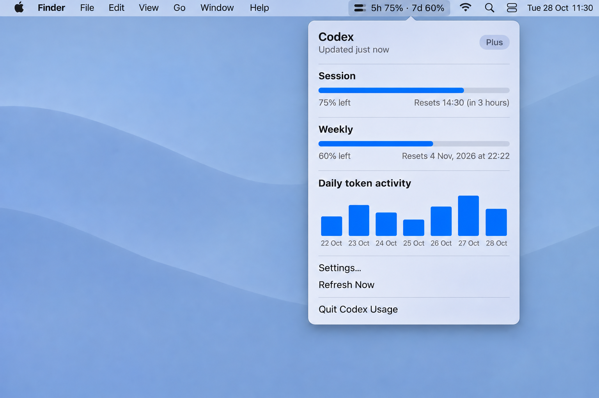

# Codex Usage

A small native macOS menu bar app for keeping an eye on your Codex usage. See your five-hour and weekly limits, reset times, and daily token activity without leaving your work.

## Preview

Illustration of the menu with example usage.



## Features

- Five-hour and weekly usage remaining, with reset times.
- A daily token activity chart for up to seven reported dates. Hover over a bar for its exact count.
- Additional limits, model names, and reset credits when Codex reports them.
- Optional notifications at 10% or 5% remaining.
- Automatic refresh every two minutes and after waking your Mac. The last successful reading stays visible while refreshing or if a request fails.

Daily token totals are separate from your plan's usage limits. Availability depends on what your Codex account and CLI version report; model names on additional limit buckets are not a per-model token breakdown.

## Requirements

- macOS 12 or later.
- Xcode Command Line Tools (`xcode-select --install`).
- A recent [Codex CLI](https://developers.openai.com/codex/cli/) signed in with a ChatGPT account. Run `codex login` in Terminal if needed.

The app finds Codex in common installation paths, including Homebrew, npm, pnpm, and nvm. It uses your existing Codex sign-in; it does not need a separate API key. An API-key-only Codex login is not supported.

## Build and run

Clone the repository, open its directory in Terminal, and run:

```sh
bash scripts/build.sh
open "build/Codex Usage.app"
```

The app appears in the menu bar rather than the Dock. Click its indicator to see details, change settings, refresh, or quit. To keep the app somewhere else, copy the built app to your Applications folder.

The build is signed locally for use on your Mac; it is not a notarized distribution. Anyone building from source needs the tools listed above.

## Notifications

On first launch, macOS asks for notification permission. Alerts are optional and can be enabled in the app's Settings menu at either 10% or 5% remaining. macOS remembers your permission choice.

## How it works and privacy

The app starts the local Codex app server and requests account information, rate limits, and daily usage. Codex handles authentication; this app does not read or store your access tokens.

The latest reported usage, daily token activity, and account identifiers are stored locally in macOS preferences for display on the next launch. Cached data can remain visible when a refresh fails. The app checks account identity when Codex provides it and clears readings when it detects an account change.

Daily activity uses the dates returned by Codex. The service does not specify a timezone for these buckets. This app does not calculate costs or derive token counts from quota percentages.

The app relies on the Codex app-server interface; changes to Codex or account availability may affect the information it can display. It is an independent project and is not affiliated with OpenAI.

## Development

The project uses Swift and AppKit, with no third-party dependencies. Source files are organized by app lifecycle, Codex communication, models, storage, notifications, and UI.

Run the parser, reader, and native menu checks with:

```sh
bash scripts/test.sh
```

The reader checks use local fake Codex responses and do not require an account. The menu checks require macOS and AppKit.
